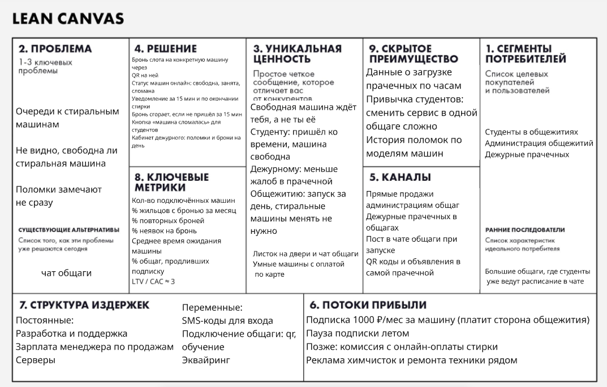

# Барабан: стирка по записи в общежитиях

## Задание 1

Бизнес-модель: B2B2C. Платит администрация общежития, за каждую подключённую машину. Для студентов сервис бесплатный. Со стороны общежития с сервисом работает дежурный прачечной.

Это мобильное приложение для iOS и Android. QR-код на машине ведёт на скачивание приложения, а если оно уже установлено, сразу открывает эту машину. Уведомления приходят пушами.

### Elevator Pitch

В общаге на несколько сотен человек обычно 5-8 стиральных машин. Все караулят свободную, смотрят в чат общаги, а потом находят в барабане чужие мокрые вещи. Барабан - это запись на стирку, как к врачу. Видно, какая машина свободна, можно забронировать время, а когда стирка закончится, придёт уведомление. Менять машины не нужно: на каждую клеится QR-код, и общежитие можно подключить за день. Студенты не стоят в очередях, а администрация наконец видит, как загружены машины и какие сломались. Ищем общежитие для бесплатного пилота, можем запустить за день.

### Lean Canvas

## Задание 2

### Риски
- Ценность. Студенты могут так и остаться на чате и не будут бронировать и сканировать QR.
- Жизнеспособность. Общежитию незачем платить, если расписание в чате бесплатное. У госвузов закупка может быть долгой.
- Осуществимость. Машины к системе не подключены, так что статус держится на студентах. Забыл отсканировать - статус неверный.
- Юзабилити. Если бронировать дольше, чем сходить и посмотреть, бронировать никто не будет. Плюс приложение сначала нужно скачать, и часть людей отвалится уже на этом шаге.

Самый критичный - риск ценности. Если студенты не будут пользоваться сервисом, продавать общежитию нечего.

### HADI

H: если дать студентам одной общаги бронь и статус машин по QR, то за 3 недели хотя бы 30% тех, кто пользуется прачечной, забронируют стирку, и минимум 40% из них забронируют ещё раз.

A: запускаем всё вручную в одном общежитии на 6 машин. Приложение для этого не пишем, вместо него телеграм-бот. На машины клеим QR-коды, они ведут в бот. Пишем в чат общаги и вешаем объявление в прачечной. Длится 3 недели, тратим около 2000₽ на печать QR-кодов и объявлений.

D: смотрим, сколько человек забронировали хотя бы раз (сравниваем с тем, сколько человек пользуется прачечной, по словам дежурного), сколько броней повторных, сколько неявок и сколько раз отметили поломку. В конце короткий опрос.

I:
- 30% и больше бронировали, 40% и больше повторно - гипотеза подтвердилась;
- от 15 до 30% - разбираемся, что мешает (неудобный бот, не верят статусу), и повторяем;
- меньше 15% - значит, проблема не та, пересматриваем идею.

### Юнит-экономика

Юнит - общежитие с оплаченной подпиской. Считаю, что в среднем это 6 машин.

Воронка (продаём в Москве и Питере):

| Шаг | Конверсия | Сколько |
|---|---|---|
| Общежития в базе, пишем и звоним | | 200 |
| Встреча с администрацией | 20% | 40 |
| Бесплатный пилот на 4 недели | 50% | 20 |
| Оплатили после пилота | 40% | 8 |

Во что обходится привлечение:
- менеджер по продажам, 2 месяца по 80 000 ₽ = 160 000 ₽
- реклама, студенческие форумы = 30 000 ₽
- подключение пилотов, 20 по 2000 ₽ = 40 000 ₽ (наклейки, доставка, обучение дежурного)

CAC = (160 000 + 30 000 + 40 000) / 8 = 28 750 ₽

LTV:
- выручка 6 × 1000 = 6000 ₽ в месяц, это около 7 ₽ с одной стирки, если в месяц их примерно 900
- расходы 1300 ₽ в месяц: серверы и SMS-коды для входа 300, поддержка 800, эквайринг и новые наклейки 200
- остаётся 4700 ₽ в месяц
- договор на учебный год, летом подписка стоит на паузе, поэтому платят 10 месяцев в году. Предположим, что общежитие остаётся в среднем на 2 года, это 20 платных месяцев

LTV = 4700 × 20 = 94 000 ₽

LTV / CAC = 94 000 / 28 750 ≈ 3,3. Больше трёх, значит экономика сходится. Затраты на привлечение возвращаются примерно за 6 платных месяцев.

Но запас небольшой. Если общежития будут уходить после первого года (10 месяцев), LTV станет 47 000 ₽, а отношение упадёт до 1,6, и всё перестанет сходиться. Поэтому главное, за чем надо следить, это продлевают ли подписку на второй год.

### Pivot

Если продажи вузам растянутся дольше 3 месяцев, из пилота будут платить меньше 20% или общежития будут уходить раньше чем через год, переключаемся на другой сегмент: коммерческие прачечные самообслуживания, а ещё прачечные в хостелах, апарт-отелях и ЖК.

Почему это должно сработать:
- решение принимает сам владелец, без тендеров, так что продавать быстрее и дешевле;
- прачечная работает круглый год, платят 12 месяцев, а не 10;
- для владельца загрузка машин сразу выражается в деньгах, ему проще объяснить, зачем это.

Бронь, QR-статусы, уведомления и кабинет администратора остаются как есть. Добавить придётся онлайн-оплату стирки: коммерческой прачечной она нужна, и с неё можно брать комиссию.

Pitch для этой версии: клиенты прачечной бронируют машину заранее и платят за стирку с телефона. Владелец получает загрузку без пиков и простоев и видит выручку по каждой машине, ничего не меняя в оборудовании.

## Задание 3

### Роли

- Студент - живёт в общаге, бронирует и стирает.
- Дежурный прачечной - отмечает поломки, следит за порядком и связывается с нами, если что-то не так.
- Администратор платформы - это мы, подключаем новые общежития и делаем QR-коды.
- Администрация общежития - платит за сервис и получает отчёты о загрузке и поломках.

### User Stories и RICE

Оценивала по RICE, шкала 1-2-3: Reach 1 (мало юзеров) - 3 (почти все), Impact 1 (слабый эффект) - 3 (геймчейнджер), Confidence 1 (просто идея) - 3 (железобетонно уверены), Effort 1 (пара дней) - 3 (квартал). Итог = (R × I × C) / E.

| ID | История | R | I | C | E | RICE | Куда |
|---|---|---|---|---|---|---|---|
| US-01 | Как студент, я хочу войти по номеру телефона и выбрать своё общежитие, чтобы видеть машины своей прачечной. | 3 | 3 | 3 | 1 | 27 | MVP |
| US-02 | Как студент, я хочу видеть статус каждой машины и сколько осталось до конца стирки, чтобы не ходить в прачечную зря. | 3 | 3 | 3 | 2 | 13,5 | MVP |
| US-03 | Как студент, я хочу забронировать время на свободной машине, чтобы прийти и не стоять в очереди. | 3 | 3 | 3 | 2 | 13,5 | MVP |
| US-04 | Как студент, я хочу отменить бронь, чтобы время могли занять другие. | 3 | 2 | 3 | 1 | 18 | MVP |
| US-05 | Как студент, я хочу отсканировать QR на машине, чтобы отметить, что начал стирку по своей брони. | 3 | 3 | 2 | 1 | 18 | MVP |
| US-06 | Как студент, я хочу получать напоминание за 15 минут до брони и сообщение, когда стирка закончилась, чтобы не опоздать и вовремя забрать вещи. | 3 | 2 | 3 | 2 | 9 | MVP |
| US-07 | Как студент, я хочу сообщить, что машина сломалась, чтобы её быстрее починили и на неё никто не записывался. | 2 | 2 | 3 | 1 | 12 | MVP |
| US-08 | Как дежурный, я хочу отмечать машину сломанной и снова рабочей, чтобы на сломанную нельзя было записаться. | 3 | 3 | 3 | 1 | 27 | MVP |
| US-09 | Как администратор платформы, я хочу добавить новое общежитие и сделать QR-коды для его машин, чтобы запустить пилот за один день. | 1 | 3 | 3 | 1 | 9 | MVP |
| US-10 | Как дежурный, я хочу настраивать правила (длину слота, сколько броней в неделю можно одному человеку), чтобы машины доставались всем по-честному. | 3 | 2 | 2 | 2 | 6 | MLP |
| US-11 | Как дежурный, я хочу видеть все брони на день, чтобы разбираться со спорами в прачечной. | 1 | 2 | 3 | 1 | 6 | MLP |
| US-12 | Как студент, я хочу видеть, в какие часы в прачечной обычно пусто, чтобы выбрать время без очереди. | 3 | 1 | 2 | 1 | 6 | MLP |
| US-13 | Как студент, я хочу встать в лист ожидания на занятое время, чтобы получить его, если кто-то отменит бронь. | 2 | 2 | 2 | 2 | 4 | MLP |
| US-14 | Как администрация общежития, я хочу получать отчёт о загрузке и поломках за месяц, чтобы было чем обосновать ремонт или новые машины. | 1 | 2 | 2 | 2 | 2 | MLP |
| US-15 | Как студент, я хочу платить за стирку в приложении, чтобы не таскать с собой карту. | 3 | 3 | 1 | 3 | 3 | Позже |
| US-16 | Как студент, я хочу, чтобы машина сама передавала свой статус, чтобы не сканировать QR. | 3 | 2 | 1 | 3 | 2 | Позже |

### MVP и MLP

В MVP входят US-01 - US-09. Это минимум, без которого сервис не работает: вход, статусы машин, бронь и отмена, QR, уведомления, поломки и подключение общежития. Машины к системе не подключаем и оплату не трогаем, студенты платят как раньше (или бесплатно, если стирка входит в проживание). Так общежитию ничего не нужно покупать и переделывать.

MLP = MVP + US-10 - US-14. Это то, что делает сервис приятным: честные правила, расписание для дежурного, подсказка, когда пусто, лист ожидания. Отчёты для администрации тоже здесь, потому что это главный повод продлить подписку.

Онлайн-оплату и автоматический статус от машины (US-15, US-16) откладываем. Это дорогие интеграции, и браться за них стоит, когда станет понятно, что сервисом пользуются. Или раньше, если придётся делать Pivot в коммерческие прачечные.

### Требования к двум главным историям

#### US-02. Статус машин

Функциональные:

- FR-02.1. Я могу видеть все машины своего общежития: номер, тип (стиральная или сушильная) и статус.
- FR-02.2. Я могу видеть у каждой машины один из статусов: «Свободна», «Забронирована на ЧЧ:ММ», «Стирка, осталось N мин», «Ждёт выгрузки», «Неисправна».
- FR-02.3. Я могу отсканировать QR на машине по своей брони и выбрать программу на 30, 60 или 90 минут. После этого машина получает статус «Стирка», и я вижу, во сколько стирка закончится.
- FR-02.4. Я могу нажать «Забрал вещи», и машина снова станет «Свободна». Если я этого не сделаю, машина освободится сама через 15 минут после конца стирки.
- FR-02.5. Я могу видеть, с какого числа машина неисправна. Забронировать неисправную машину я не могу.
- FR-02.6. Я не могу видеть имя и телефон того, кто занял машину.
- FR-02.7. Я могу видеть предупреждение «Данные могли устареть» и время последнего обновления, если данные не обновлялись больше 60 секунд.

Нефункциональные:

- NFR-02.1. Когда в одном общежитии одновременно сидят 50 человек, экран прачечной открывается за 1,5 секунды или быстрее минимум в 95% случаев (сеть 4G).
- NFR-02.2. После сканирования QR новый статус видят все в общежитии не позже чем через 5 секунд.
- NFR-02.3. Приложение работает на iOS 15 и новее и на Android 9 и новее, экран нормально выглядит на ширине от 360 px.

#### US-03. Бронь

Функциональные:

- FR-03.1. Я могу забронировать слот фиксированной длины (по умолчанию 90 минут) в часы работы прачечной (по умолчанию 8:00-23:00). Время я вижу по часовому поясу общежития.
- FR-03.2. Я могу бронировать на сегодня и на 2 дня вперёд. Прошедшее время, время вне часов работы и сломанную машину я выбрать не могу.
- FR-03.3. Я могу иметь только 1 активную бронь и не больше 3 броней в неделю. Если лимит исчерпан, я вижу, с какого дня смогу записаться снова.
- FR-03.4. Если слот заняли раньше меня, я вижу сообщение «Слот только что заняли» и 3 ближайших свободных слота.
- FR-03.5. Я могу видеть машину, время и номер брони в разделе «Мои брони» и получаю push-уведомление с подтверждением.
- FR-03.6. Если я не отсканирую QR в течение 15 минут после начала слота, бронь отменится и засчитается неявка. После 3 неявок за 30 дней я не могу бронировать 7 дней.
- FR-03.7. Если машину, на которую у меня бронь, отметили сломанной, я получаю уведомление об отмене и могу выбрать свободное время на другой машине.

Нефункциональные:

- NFR-03.1. При 30 запросах на бронь в секунду 95% броней подтверждаются за 1 секунду или быстрее.
- NFR-03.2. Если 50 человек одновременно пытаются забронировать один и тот же слот, получается только у одного. Повторная отправка того же запроса не создаёт вторую бронь.
- NFR-03.3. Данные передаются только по HTTPS. Телефоны хранятся в зашифрованном виде на серверах в России (152-ФЗ). Бронь видят только сам студент и дежурный его общежития.
- NFR-03.4. Чтобы забронировать машину с экрана прачечной, нужно не больше 3 нажатий.

И общее требование ко всему MVP: сервис доступен минимум 99,5% времени за месяц (это не больше 3,6 часа простоя), плановые работы с 3:00 до 5:00 не считаются.
